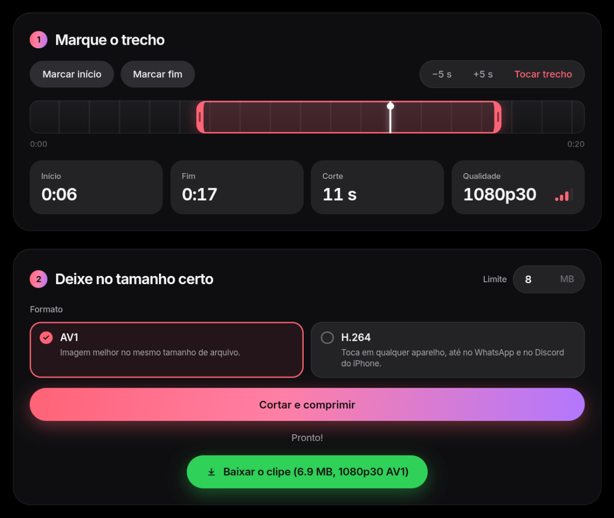

# Atena

Cortador de clipes que roda no navegador. Escolha um vídeo, marque o melhor momento e baixe o clipe já no tamanho certo.

**Usar agora:** https://ruanmacedo-dev.github.io/atena/

## Como usar

1. Clique em **Escolher vídeo**.
2. Ache o começo do momento e clique em **Marcar início**. Para chegar lá, dê play, arraste a agulha branca da barra ou use **−5 s** e **+5 s**.
3. Ache o fim do momento e clique em **Marcar fim**.
4. Clique em **Tocar trecho** para conferir o corte antes de baixar.
5. Em **Limite**, escreva o tamanho máximo que o arquivo pode ter, em MB.
6. Em **Formato**, escolha **AV1** ou **H.264** (a diferença está logo abaixo).
7. Clique em **Cortar e comprimir** e, quando terminar, em **Baixar o clipe**.

## O que ela faz por você

- **Se o trecho já cabe no limite**, ela só corta, sem mexer na qualidade. Para isso, o vídeo precisa ter um quadro-chave (um ponto em que a imagem recomeça do zero) até 3 segundos antes do início que você marcou. A plaquinha **Qualidade** mostra **Original** quando dá.
- **Se não cabe**, ela comprime com a mesma qualidade do começo ao fim, sem borrar as cenas de ação. Antes, comprime uns pedacinhos do trecho para medir o vídeo e acertar o tamanho já na primeira vez.
- **Escolhe sozinha a resolução e os quadros por segundo.** Clipes curtos saem em 1080p com 60 quadros por segundo. Nos mais longos ela passa para 30 quadros por segundo, que deixam cada imagem mais nítida no mesmo tamanho de arquivo. Só em trechos bem longos ela desce para 720p, 480p ou 360p. Ela nunca passa da resolução nem dos quadros por segundo do vídeo original. A plaquinha **Qualidade** mostra a previsão antes de você clicar.
- **Você escolhe o formato.** O **AV1** entrega imagem melhor no mesmo tamanho de arquivo. O **H.264** toca em qualquer aparelho, até no WhatsApp e no Discord do iPhone, com imagem um pouco pior no mesmo tamanho. Se o navegador não conseguir gerar AV1, ela usa H.264, e o botão de baixar mostra qual saiu.
- **Deixa o som mais leve.** Junto com o AV1, o som vai em Opus, que soa igual e ocupa metade do espaço. O que sobra vai para a imagem. Com **H.264**, o som fica como no original.

## Seu vídeo não sai do seu computador

Tudo acontece dentro do seu navegador. O vídeo não é enviado para nenhum servidor.

## Navegadores

Feita para navegadores baseados no Chromium (Chrome, Edge, Vivaldi, Brave), atualizados. Testada no Vivaldi, no Linux. Outros navegadores e celulares ainda não foram testados.

## Arquivos

| Arquivo | O que tem |
| --- | --- |
| `index.html` | o que aparece na tela |
| `estilo.css` | as cores e o visual |
| `script.js` | o que acontece quando você clica |
| `icone.svg`, `icone-32.png`, `icone-180.png` | o ícone da aba e da tela inicial do celular |
| `tela.png` | a imagem deste README |

## Feito com

- HTML, CSS e JavaScript, sem framework.
- [Mediabunny](https://mediabunny.dev/) para cortar e comprimir o vídeo (licença MPL-2.0).
- [Inter](https://rsms.me/inter/) como fonte (licença OFL-1.1).
